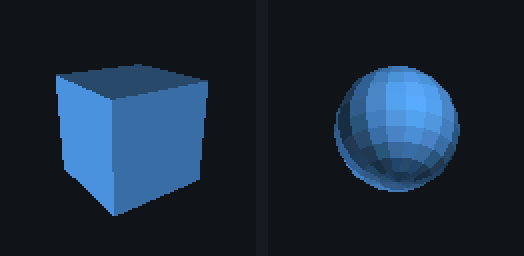

# embedded-3d

A tiny portable **3D rasterizer for micro controllers**, in plain C99.
No malloc, no dependencies, and a Q16.16 pipeline that avoids floating point
entirely for the parts that run per vertex and per pixel.

*128x128, RGB565, 16 bit depth, back face culling, flat shading - rendered by examples/demo.*

## Tiers

A tier is a named preset of render flags plus a choice of draw interface. It is
not a separate build: the same library serves all three, and the feature you do
not need is compiled out.

| tier | draw with | transform | depth | clipping | shading | typical target |
|---|---|---|---|---|---|---|
| MINIMAL | embd3d_draw_mesh_fx | Q16.16 | 8 bit | near | depth tint (no lighting) | AVR, 8051, Cortex-M0 |
| BALANCED | embd3d_draw_mesh | float | 16 bit | near | per face | Cortex-M3/M4, ESP32 |
| QUALITY | embd3d_draw_mesh_cached | float | 16 bit | 6 planes | per face | Cortex-M4F/M7, RP2040, ESP32-S3 |

    embd3d_render_ctx_t ctx;
    embd3d_render_ctx_init_tier(&ctx, EMBD3D_TIER_QUALITY, 0.5f, 30.0f);

    /* ask the library which interface this tier prefers on this build */
    if (embd3d_tier_precision(EMBD3D_TIER_MINIMAL) == EMBD3D_PRECISION_FIXED) {
        embd3d_mat4_fx_t mvp_fx;
        embd3d_mat4_to_fx(mvp_fx, mvp);
        embd3d_draw_mesh_fx(&fb, &mesh_fx, mvp_fx, &ctx);
    }

Tiers are a starting point, not a cage: every flag can be changed afterwards
(CULL_BACK, WIREFRAME, FULL_CLIP, UNLIT), and the precision is chosen by which
draw function you call.

## Layout

    src/                        the library (flat, so Arduino picks it up as-is)
      embd3d.h                  umbrella header
      embd3d_config.h           compile time configuration and tier switches
      embd3d_vec3.{h,c}         vector math
      embd3d_mat4.{h,c}         4x4 row-vector matrices (float)
      embd3d_fixed.{h,c}        Q16.16 matrices and mesh conversion
      embd3d_framebuffer.{h,c}  pixel format, clear, RGB888 export
      embd3d_raster.{h,c}       triangle / line rasterizer with depth test
      embd3d_mesh.h             indexed triangle list (float and fixed)
      embd3d_render.{h,c}       tiers, clipping, projection, shading, cache
    examples/
      demo/                     headless PPM renderer (cube or sphere, float or fx)
      arduino/embd3d_spin/      the same pipeline on an Arduino + OLED
    tests/test_embd3d.c         unit tests, built once per tier by CTest
    docs/DESIGN.md              why the implementation looks like it does

## Quick start

    #include <embd3d.h>

    #define W 128
    #define H 128
    static embd3d_pixel_t color[W * H];
    static embd3d_depth_t depth[W * H];

    static const embd3d_real_t verts[] = {
        -1, -1, 0,   1, -1, 0,   1, 1, 0,   -1, 1, 0,
    };
    static const embd3d_index_t tris[] = { 0, 1, 2,  0, 2, 3 };

    void frame(float yaw) {
        embd3d_framebuffer_t fb;
        embd3d_fb_init(&fb, color, depth, W, H);

        embd3d_render_ctx_t ctx;
        embd3d_render_ctx_init(&ctx, 0.5f, 30.0f);                  /* near, far */

        embd3d_mat4_t proj, view, vp, model, mvp;
        embd3d_mat4_perspective(proj, 45.0f, 1.0f, 0.5f, 30.0f);    /* fov in DEGREES */
        const embd3d_vec3_t eye = { 0, 0, 6 }, at = { 0, 0, 0 }, up = { 0, 1, 0 };
        embd3d_mat4_look_at(view, &eye, &at, &up);
        embd3d_mat4_mul(vp, view, proj);

        embd3d_mat4_rotation_y(model, yaw);
        embd3d_mat4_mul(mvp, model, vp);

        embd3d_mesh_t mesh = { verts, tris, 4, 2, EMBD3D_RGB(90, 170, 255) };

        embd3d_fb_clear(&fb, EMBD3D_RGB(0, 0, 0));
        embd3d_draw_mesh(&fb, &mesh, mvp, model, &ctx);
    }

### The integer pipeline

Same scene, no float in the transform, the clipping or the rasterizer:

    static embd3d_fx_t verts_fx[4 * 3];           /* Q16.16, fill once at load */
    embd3d_fx_t buf[4 * 3];
    embd3d_mesh_positions_to_fx(buf, verts, 4);
    embd3d_mesh_fx_t mesh_fx = { buf, tris, 4, 2, EMBD3D_RGB(90, 170, 255) };

    embd3d_mat4_fx_t mvp_fx;
    embd3d_mat4_to_fx(mvp_fx, mvp);               /* once per frame */
    embd3d_draw_mesh_fx(&fb, &mesh_fx, mvp_fx, &ctx);

On a no-FPU part this is the difference between a few integer multiplies and a
software float call per component; on a Cortex-M4F the float path wins instead.
Both are kept in one library so the same application source can move between
boards. The integer pipeline draws with the mesh colour (no per face lighting);
set EMBD3D_ENABLE_LIGHTING=0 as well and no floating point code is linked at all.

### Vertex cache

Optional, caller owned, 28 bytes per vertex. Turns roughly 6 transforms per
vertex into 1 for a closed mesh:

    static uint8_t cache_mem[EMBD3D_VERTEX_CACHE_STRIDE * 700];
    embd3d_vertex_cache_t cache;
    embd3d_vertex_cache_init(&cache, cache_mem, 700);
    embd3d_draw_mesh_cached(&fb, &mesh, mvp, &model, &ctx, &cache);

Build and run the headless demo:

    cmake -S . -B build && cmake --build build
    ./build/embd3d_demo out.ppm                # cube, float pipeline
    ./build/embd3d_demo out.ppm --sphere --fx  # sphere, Q16.16 pipeline
    ctest --test-dir build                   # runs the suite once per tier

## Conventions

* Matrices are **row major** and act on **row vectors**: v' = v * M. Translation
  lives in the last *row* (indices 12..14). Composition order is therefore
  mvp = model * view * projection.
* Every matrix function takes the **destination first**: embd3d_mat4_mul(dst, a, b).
* embd3d_mat4_perspective() takes the field of view in **degrees**.
* Screen space has **y down**; NDC has y up, so projection flips y.
* Depth is a 1/w key: **bigger means nearer**, 0 is the clear value.
* Meshes are indexed triangle lists, indices are **0 based**, uint16_t by default.
* Q16.16 covers +-32768 with 1/65536 resolution. Scale your model into that range.

## Configuration

Everything is a macro in src/embd3d_config.h, overridable from the build system
(-DEMBD3D_ENABLE_FIXED=0) or a project header, before embd3d.h is included.

| macro | default | effect |
|---|---|---|
| EMBD3D_ENABLE_FLOAT | 1 | build the float vertex pipeline (embd3d_draw_mesh) |
| EMBD3D_ENABLE_FIXED | 1 | build the Q16.16 pipeline (embd3d_draw_mesh_fx) |
| EMBD3D_ENABLE_LIGHTING | 1 | per face flat shading; 0 removes all float maths |
| EMBD3D_ENABLE_FULL_CLIP | 1 | 6 plane clipping; 0 keeps only the near plane |
| EMBD3D_ENABLE_VERTEX_CACHE | 1 | the shared vertex cache |
| EMBD3D_REAL | float | scalar type for vectors/matrices (double also works) |
| EMBD3D_COLOR_FORMAT | 0 | 0 = RGB565 (2 B/px), 1 = L8 luminance (1 B/px) |
| EMBD3D_DEPTH_BITS | 16 | 16 (2 B/px) or 8 (1 B/px) depth levels |
| EMBD3D_INDEX_TYPE | uint16_t | mesh index type |
| EMBD3D_VALIDATE_MESH | 0 | range check mesh indices while you build a mesh |
| EMBD3D_SUBPIXEL_BITS | 4 | rasterizer subpixel precision; 4 is safe to ~570 px wide, each extra bit halves that (int32 edge functions) |

Render flags (ctx.flags):

| flag | effect |
|---|---|
| EMBD3D_FLAG_CULL_BACK | drop clockwise (in NDC) triangles |
| EMBD3D_FLAG_WIREFRAME | draw edges instead of filling |
| EMBD3D_FLAG_FULL_CLIP | clip all 6 planes, not just the near one |
| EMBD3D_FLAG_UNLIT | skip per-face lighting |
| EMBD3D_FLAG_DEPTH_TINT | unlit depth cue: nearer faces are brighter |

Frame buffer footprint at 128x128:

| color | depth | total |
|---|---|---|
| RGB565 | 16 bit | 64 KiB |
| RGB565 | 8 bit | 48 KiB |
| L8 | 8 bit | 32 KiB |

Drivers that want 3 bytes per pixel (what many OLED controllers take) can call
embd3d_fb_export_rgb888() on the finished frame instead of paying for a bigger
buffer all the time.

Library code size, x86-64, -Os, text + rodata (use your own toolchain for real
flash numbers; the ratios are the point):

| build | size |
|---|---:|
| both pipelines | 12.7 KiB |
| float only | 9.9 KiB |
| Q16.16 only | 9.6 KiB |
| AVR minimal (fixed, unlit, near clip only, no cache, 8 bit L8) | 8.4 KiB |

## Performance

Cost inside this library, measured on one x86-64 host with GCC 13 (1280 triangle
sphere, 128x128 target). Relative to the float path, which is the baseline:

| variant | -O3 | -Os |
|---|---:|---:|
| float | baseline | baseline |
| float + vertex cache | -13% | -14% |
| Q16.16 | +15% | +10% |
| Q16.16 + vertex cache | -10% | -15% |

Absolute figures move by tens of percent between machines and between runs, so
only the ratios are published.

Two things this table does **not** say:

* the Q16.16 rows are *slower* here because this host has a hardware FPU. On a
  Cortex-M0 or an AVR the same code is typically several times faster than the
  float path, because a float multiply becomes a library call. docs/DESIGN.md
  has a per-operation cost model you can plug your own cycle counts into.
* host numbers mean nothing for your MCU. The ratios and the operation counts do.

## Correctness

* The two pipelines are compared pixel by pixel in the test suite: for an unlit
  scene the Q16.16 and float images are **bit identical** (0 of 16384 pixels
  differ), so switching precision does not change what you see.
* The vertex cache is checked to be bit identical to the uncached path, and to
  fall back silently when the buffer is too small.
* Two triangles sharing an edge rasterize to exactly the full quad, i.e. no
  one-pixel cracks: a strict point-in-triangle test leaves a hole along every
  shared edge, and this rasterizer does not.
* ctest builds and runs the suite once per tier configuration (10 targets), so a
  feature combination that stops compiling or passing fails immediately.

## Status and known limitations

* Flat shading only, one directional light, no textures, no Gouraud.
* The Q16.16 pipeline is unlit: per face lighting there would need an integer
  sqrt per face, which costs more than the AVR can afford. EMBD3D_FLAG_DEPTH_TINT
  gives a cheap depth cue instead, but for compact objects the depth spread is
  small and the result still reads flatter than real shading - on that tier,
  baking colours per face into the mesh is the way to get shape cues.
* One clip plane by default. Triangles straddling the side planes are handled by
  the bounding box clamp, which is correct but feeds more off-screen fragments to
  the rasterizer; EMBD3D_FLAG_FULL_CLIP clips all six for ~200 bytes of stack.
* No top-left fill rule: overlapping fragments on shared triangle edges rely on
  the depth test. Fine for opaque rendering; add the rule before blending.
* No perspective correct attributes yet (nothing needs them without textures).
* The library never allocates and never blocks: everything is caller owned.

## License

MIT - see [LICENSE](LICENSE). Copyright (c) 2026 ForForgot.
